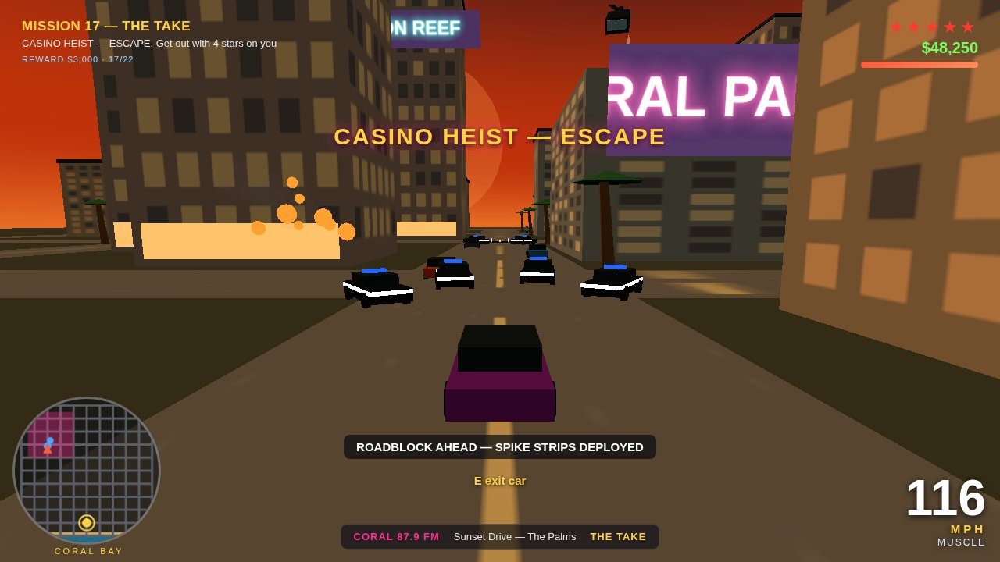
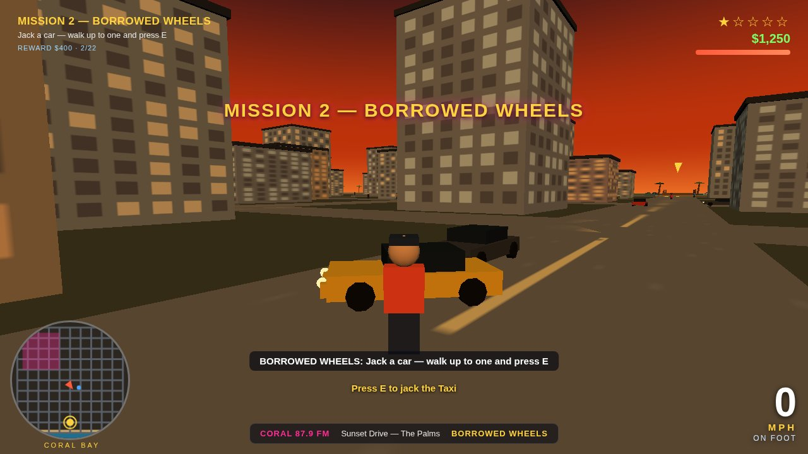
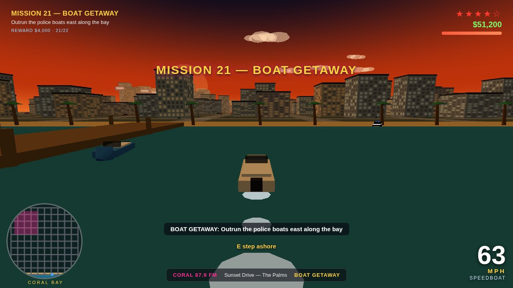
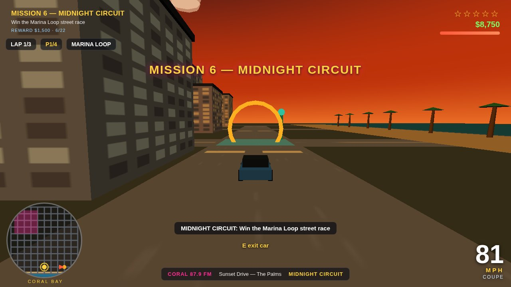

# CORAL HEAT

A 3D WebGL open-world crime game set in a sunset coastal marina city — explore on foot and by car, outrun the police, and pull off a casino heist.

**Bounty:** https://make.fun/bounty/gta6-01

> All city, character, vehicle, and story names are original. CORAL HEAT contains no Rockstar names, art, music, or map.

## What it is

CORAL HEAT is a 3D open-world crime game built with three.js. You play in a sunset coastal marina city with traffic, pedestrians, a wanted system, police pursuits, story missions, street races, and a casino-heist finale — on foot, by car, by motorcycle, and by boat.

The game runs entirely from static files, with three.js vendored locally and no network requests.

## Features

- Open-world coastal marina city, on foot and by car
- Traffic and pedestrians, with stealable cars and carjacking
- Wanted level, police pursuits, and a police helicopter with a visible searchlight beam
- Police roadblocks with spike strips
- Combat, weapon wheel UI, and explosion, fire, and smoke particles
- HUD with minimap
- Start screen and save support via localStorage
- Radio
- Shops and garage, with 3 safehouses
- Motorcycles (3 models)
- Boats and a marina district — marina-front boulevard, pier, moored boats, and a speedboat underway
- Street races (5 circuits)
- Neon casino district with lit signage, lit building windows, and an enterable casino building for the heist
- Improved sky with gradient, clouds, and sun glare
- Denser traffic and more pedestrians

## Missions

22 story missions, including a casino-heist finale chain:

- **Casino-heist chain** — recon, getaway driver, vault, and escape by boat
- **Mission 21** — boat getaway after the heist
- **Mission 22** — waterfront pursuit with police boats

## Controls

| Key | Action |
| --- | --- |
| WASD | Drive / walk |
| Mouse | Camera |
| E | Enter / exit vehicle |
| Space | Handbrake |
| Shift | Boost |
| F | Weapon wheel |
| R | Radio |
| M | Mission menu |
| Esc | Pause |

## How to run

CORAL HEAT is served as static files under `game/`, with three.js vendored locally. Serve the project directory with any static file server, then open the game from the `main.ts` entrypoint.

No network requests are needed to play.

## Screenshots

### Cover — casino-heist chase (v2.12)

The v2.12 cover restores the dense neon casino chase: ~116 MPH, 5-star wanted, 4 police cars, helicopter searchlight, a roadblock with spike strips ahead, explosion and fire glow, a "CASINO HEIST — ESCAPE" HUD banner, and sunset palms.

### On foot

### Marina and boats

Boats and the marina stay in the game and in this screenshot (missions 21–22).

### Street race

## License

MIT — see [LICENSE](LICENSE).
